<picture>
  <source media="(prefers-color-scheme: dark)" srcset="./assets/banner/dark.svg">
  
</picture>

 

### Hi, I'm Ganesh 👋

Creative Frontend Engineer from Bangalore with **4+ years** of building responsive, interactive web apps. React and TypeScript are my daily tools; Three.js and WebGL are where I experiment. I work where engineering meets design: interfaces that are fast, accessible and pleasant to use.

- 🔭 Currently building AI-assisted tools, 3D web experiences and full-stack products
- 🌌 Going deeper into **Three.js, React Three Fiber and WebGL**
- 🤝 Open to collaborating on interesting frontend and creative-coding projects

 

## 🚀 Featured Projects

  <a href="https://flipora.netlify.app"><picture><source media="(prefers-color-scheme: dark)" srcset="./assets/projects/flipbook-dark.svg">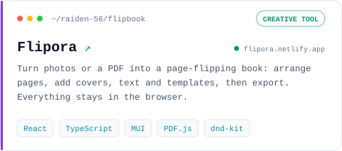</picture></a>
  <a href="https://mamta-stay.netlify.app"><picture><source media="(prefers-color-scheme: dark)" srcset="./assets/projects/hampi-stay-dark.svg">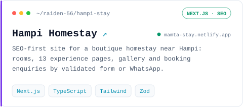</picture></a>
  <a href="https://organization-tree.netlify.app"><picture><source media="(prefers-color-scheme: dark)" srcset="./assets/projects/Organization-chart-dark.svg">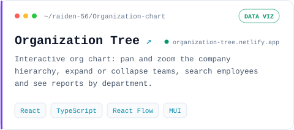</picture></a>
  <a href="https://floowpilot.netlify.app"><picture><source media="(prefers-color-scheme: dark)" srcset="./assets/projects/flowpilot-dark.svg">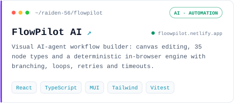</picture></a>
  <a href="https://dream-interior-design.netlify.app"><picture><source media="(prefers-color-scheme: dark)" srcset="./assets/projects/Interior-design-dark.svg">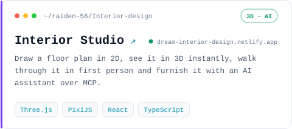</picture></a>
  <a href="https://tripore.netlify.app"><picture><source media="(prefers-color-scheme: dark)" srcset="./assets/projects/Tripora-dark.svg">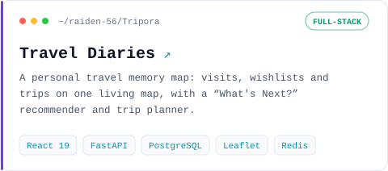</picture></a>
  <a href="https://filoraa.netlify.app"><picture><source media="(prefers-color-scheme: dark)" srcset="./assets/projects/Filora-dark.svg">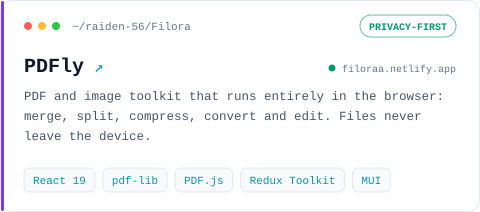</picture></a>
  <a href="https://github.com/raiden-56/towpilot"><picture><source media="(prefers-color-scheme: dark)" srcset="./assets/projects/towpilot-dark.svg">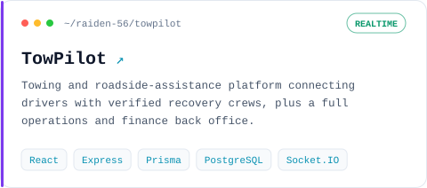</picture></a>
  <a href="https://layora.netlify.app"><picture><source media="(prefers-color-scheme: dark)" srcset="./assets/projects/Layrly-dark.svg">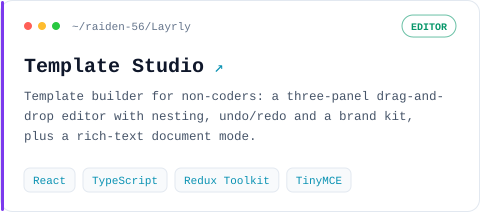</picture></a>
  <a href="https://github.com/raiden-56/ai-interview-schedule"><picture><source media="(prefers-color-scheme: dark)" srcset="./assets/projects/ai-interview-schedule-dark.svg">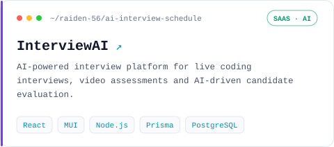</picture></a>
  <a href="https://camoora.netlify.app"><picture><source media="(prefers-color-scheme: dark)" srcset="./assets/projects/Camora-dark.svg">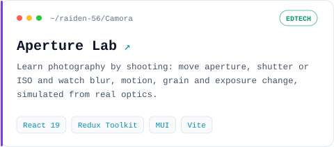</picture></a>

 

## 🧰 Tech Stack

  

 

## 📊 GitHub Activity

<picture>
  <source media="(prefers-color-scheme: dark)" srcset="https://streak-stats.demolab.com?user=raiden-56&background=0A101F&border=1E293B&stroke=1E293B&ring=A78BFA&fire=A78BFA&currStreakNum=F1F5F9&sideNums=F1F5F9&currStreakLabel=22D3EE&sideLabels=22D3EE&dates=64748B&border_radius=12">
  
</picture>

<!-- STATS: un-comment once your self-hosted github-readme-stats is live on Vercel,
     and replace STATS_HOST with your instance (e.g. github-readme-stats-raiden.vercel.app).

  <picture>
    <source media="(prefers-color-scheme: dark)" srcset="https://STATS_HOST/api?username=raiden-56&show_icons=true&hide_rank=true&include_all_commits=true&count_private=true&bg_color=0A101F&title_color=22D3EE&text_color=CBD5E1&icon_color=A78BFA&border_color=1E293B&border_radius=12">
    
  </picture>
  <picture>
    <source media="(prefers-color-scheme: dark)" srcset="https://STATS_HOST/api/top-langs/?username=raiden-56&layout=compact&langs_count=8&bg_color=0A101F&title_color=22D3EE&text_color=CBD5E1&border_color=1E293B&border_radius=12">
    
  </picture>

-->

<picture>
  <source media="(prefers-color-scheme: dark)" srcset="https://raw.githubusercontent.com/raiden-56/raiden-56/output/github-snake-dark.svg">
  
</picture>

 

## 🤝 Let's Connect

  &nbsp;&nbsp;
  &nbsp;&nbsp;
  &nbsp;&nbsp;
  

Build · Create · Experiment · Repeat

